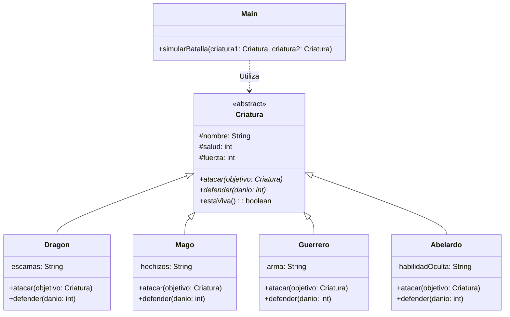

# Batalla de Criaturas - Parcial II Programación II (G412)

## Descripción del Proyecto
Este proyecto es una simulación de batallas por turnos desarrollada en Java. Implementa conceptos de la programación orientada a objetos, enfocándose en el uso de clases abstractas, herencia y polimorfismo para gestionar el comportamiento de diferentes tipos de luchadores (Dragón, Mago, Guerrero y Abelardo).

## Integrantes del Equipo
* Will Stiven Franco
* William Villa

## Uso de Inteligencia Artificial
Durante la elaboración de este ejercicio parcial empleamos IA como apoyo técnico para:
Estructuración inicial y buenas prácticas: La IA nos guio en la transición del diagrama UML al código Java, sugiriendo el uso de modificadores de acceso correctos (protected) y mejoras lógicas, como utilizar Math.max(0, daño) para evitar cálculos de vida negativos.
* Resolver dudas de sintaxis sobre la implementación correcta del polimorfismo desde la clase Main.
* Creatividad y diseño de clases: Nos ayudó a estructurar la lógica de la cuarta criatura ("Abelardo"), definiendo cómo integrar atributos únicos y escalar el daño extra respetando las reglas del polimorfismo.;
* Refinar la lógica de reducción de daño en los métodos de defensa para evitar que la salud de los personajes cayera en valores negativos.
* Y pues en las clases del README
* Y en las pruebas unitarias

## Diagrama de Clases
A continuación se presenta la estructura orientada a objetos de nuestro proyecto.

